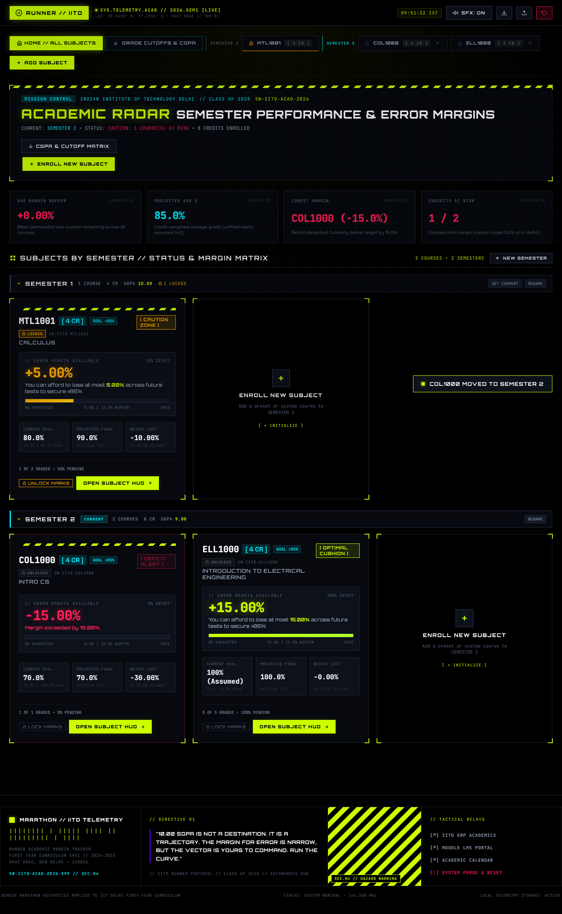
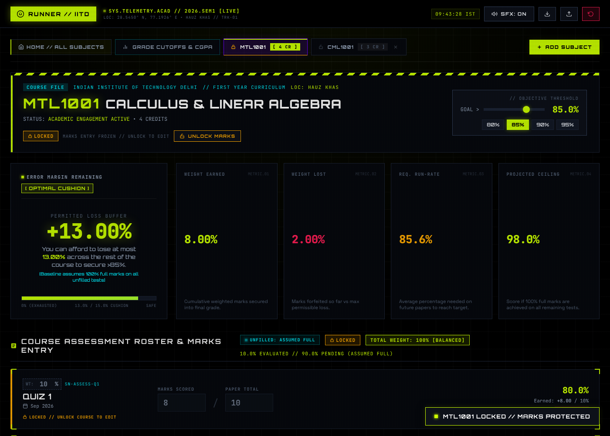
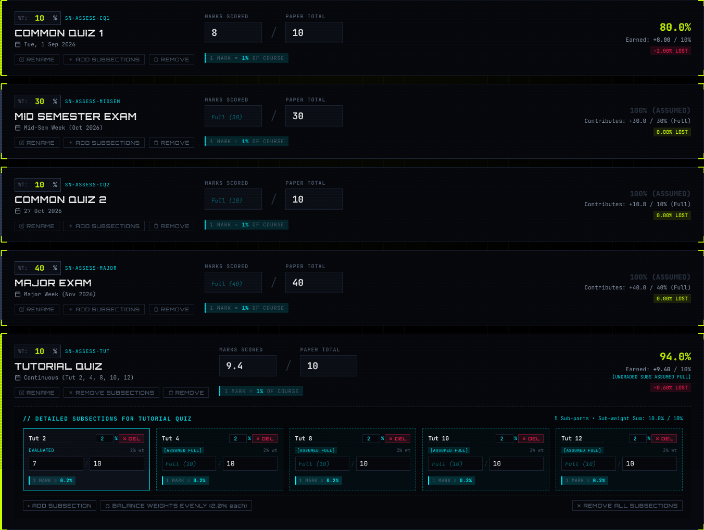
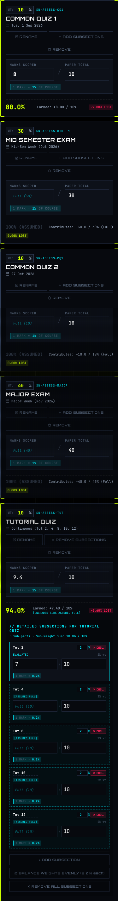
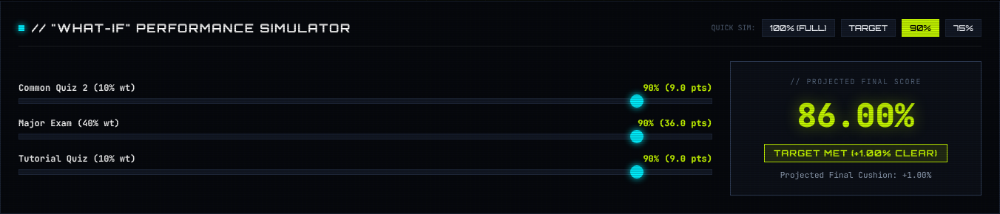
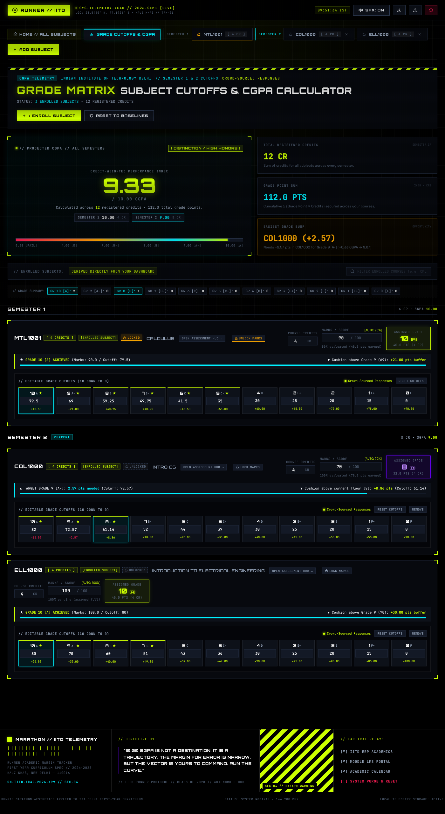
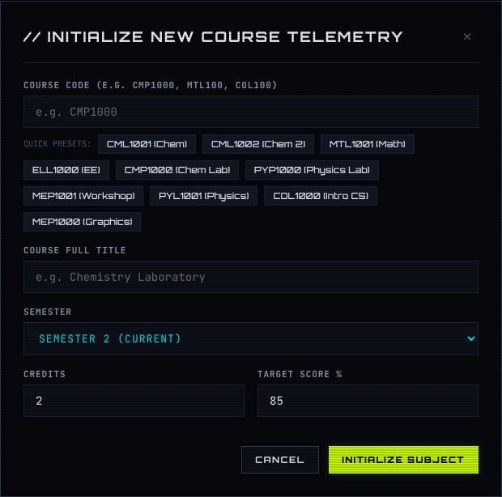
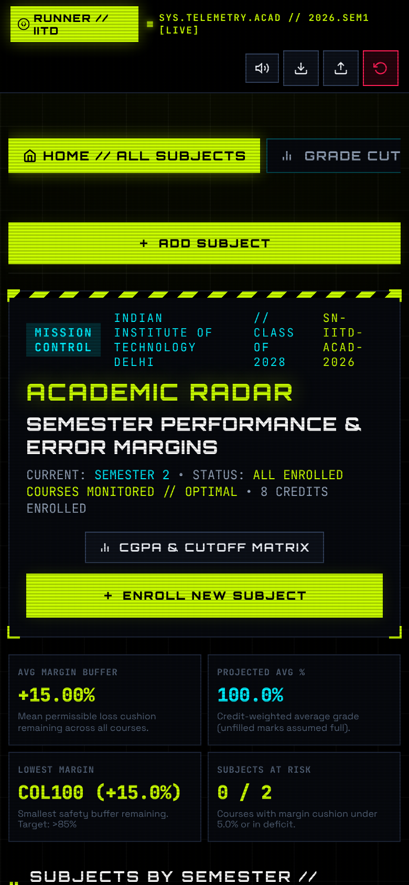

# RUNNER // IIT DELHI ACADEMIC TELEMETRY DASHBOARD
> Tactical First-Year Marks & Margin Tracker inspired by **Bungie's Marathon**

A high-octane academic performance tracking and error-margin HUD engineered specifically for IIT Delhi first-year engineering students.

---

## ⚡ Features

- [Home: all subjects by semester](#-home-all-subjects-by-semester)
- [Semesters](#-semesters)
- [Drag courses between semesters](#-drag-courses-between-semesters)
- [Course lock: protect your marks](#-course-lock-protect-your-marks)
- [Subject HUD: margin engine](#-subject-hud-margin-engine)
- [Marks entry and custom weightages](#-marks-entry-and-custom-weightages)
- [Per-mark course share](#-per-mark-course-share)
- [What-if simulator](#-what-if-simulator)
- [Grade cutoffs and CGPA calculator](#-grade-cutoffs-and-cgpa-calculator)
- [Adding subjects and presets](#-adding-subjects-and-presets)
- [Backup, import and reset](#-backup-import-and-reset)
- [Look, sound and mobile](#-look-sound-and-mobile)

### 🏠 Home: all subjects by semester



- **Top stats for the current semester**: average margin buffer, projected credit-weighted average, the course with the lowest margin, and how many subjects are at risk (cushion under 5% or in deficit).
- **One collapsible section per semester** showing its course count, credits, **SGPA** and how many of its courses are locked. The current semester is tagged `CURRENT`.
- **A card per subject** with its status zone, error margin left, current evaluation, projected final, weight lost, graded/pending count, a lock toggle, and a button to open its full HUD.
- Each semester has an **Enroll new subject** tile that adds a course straight into that semester.
- The ribbon at the top groups course tabs by semester, so you can jump to any subject from anywhere.

### 🗓 Semesters

- Courses belong to a semester. Add one with **+ New Semester**; a new semester becomes the current one.
- **Set current**, **Rename** or delete a semester from its header (a semester must be empty before it can be deleted, and at least one must remain).
- Move a course with the **Semester** dropdown on its HUD, or by dragging it (below).
- Collapsed/expanded state is remembered.
- Old saved data and old JSON backups with no semester info are moved into the current semester automatically.

### ↔️ Drag courses between semesters

- Drag a subject card on Home, or a course tab in the ribbon, and drop it on another semester.
- While dragging, empty semesters show up in the ribbon as drop targets.
- **Locked courses can't be dragged**; you get a toast asking you to unlock first. Drops follow exactly the same rules as the Semester dropdown and are saved straight away.

### 🔒 Course lock: protect your marks



- Lock any course once its marks are final, so nothing gets changed by accident.
- While locked you can't edit scores, paper totals, weights, components or subsections, can't move the course to another semester, and can't change its credits or score on the CGPA page.
- The lock shows everywhere: a padlock on the ribbon tab, a `LOCKED` badge and **Unlock marks** button on the HUD banner, Home cards and CGPA cards, a `LOCKED` badge on the assessment roster, and a lock count in each semester header.
- Trying to edit a locked course shows a toast such as `MTL1001 IS LOCKED // UNLOCK TO EDIT MARKS`.
- The lock state is saved, exported and restored on import.

### 🎯 Subject HUD: margin engine

- **Target threshold** per course (default **> 85.0%**), set with a slider or the 80 / 85 / 90 / 95% quick buttons.
- **Error margin remaining**: how many weighted percentage points you can still afford to lose and still reach your target. Unfilled papers are assumed to be full marks.
- **Status zones**:
  - `[ OPTIMAL CUSHION ]`: margin above 7.0% (volt green)
  - `[ CAUTION ZONE ]`: margin between 3.0% and 7.0% (amber)
  - `[ CRITICAL MARGIN ]`: margin at or below 3.0%, or negative (crimson)
- **Weight earned** and **weight lost** so far.
- **Required run-rate**: the average you need on all remaining papers to reach the target.
- **Projected ceiling**: the best final score possible if you ace everything left.

### ✍️ Marks entry and custom weightages

- Enter **marks scored / paper total** for every assessment. Each card shows the percentage, weight earned and weight lost.
- **Inline weights**: change any component's weightage right on its card; everything recalculates live.
- **Rename**, **remove**, or add new components (term projects, surprise quizzes, participation…) with **+ Add assessment component**.
- **Subsections**: split any component into parts (for example Tut 2, 4, 8, 10, 12 or Pre-Lab 1–5). Each part has its own weight, score and total, and can be renamed, added (`+ Add subsection`) or deleted. **Balance weights evenly** splits the parent weight equally. You can also revert a component back to a single paper.
- **Weight allocation badge** shows whether the course totals `100% [BALANCED]`, has `UNASSIGNED` weight, or is in `OVERFLOW`.

### 📏 Per-mark course share

| Desktop | Mobile |
| --- | --- |
|  |  |

- Every assessment card and every subsection shows **`1 MARK = X% OF COURSE`** (its weight divided by the paper total), so you can see at a glance how much each lost mark costs.
- It updates live when you change the score, total or weight.

### 🔮 What-if simulator



- A slider for every pending paper. Try a scenario (*"what if I get 34/40 in the major and 8/10 in CQ2?"*) and see the projected final score, whether the target is met, and the final cushion.
- Quick sims set all pending papers to **100%**, **your target**, **90%** or **75%** in one click.

### 📊 Grade cutoffs and CGPA calculator



- **Projected CGPA** across all semesters, with an **SGPA chip for each semester**, a colour-scaled CGPA bar, and a status pill (e.g. `DISTINCTION / HIGH HONORS`).
- Total registered credits, total grade points (Σ grade point × credits), and **Easiest grade bump**: the course closest to its next grade, with how many marks it needs and the CGPA it would give.
- **Grade summary** counting how many courses sit at each grade (10 down to 0).
- Course cards **grouped by semester**, each showing credits, marks/score, the assigned grade and grade points, how far you are from the next grade and your cushion above the current one.
- **Editable cutoffs (grade 10 down to 0)** for every course, prefilled with crowd-sourced IITD first-year cutoffs where known (verified grades are starred). Reset one course or **Reset to baselines** for all.
- The score comes from your dashboard marks automatically; you can override it on the card and **sync** back to the auto-calculated value later.
- Search box to filter enrolled courses, and **+ Enroll subject** to add a course from here.

### ➕ Adding subjects and presets



- **+ Add subject** opens a dialog for the course code, title, **semester**, credits and target score.
- Quick presets for IITD first-year courses fill in the details and the real assessment breakdown: `CML1001`, `CML1002`, `CMP1000`, `MTL1001`, `COL1000`, `ELL1000`, `PYL1001`, `PYP1000`, `MEP1000`, `MEP1001` (older codes `MTL100`, `COL100`, `ELL100`, `PYL100`, `APL100` are also recognised).
- Any other code gets a sensible default breakdown (two quizzes, mid-sem, tutorials, major) that you can edit.
- On first launch the dashboard starts empty and opens this dialog for you.

### 💾 Backup, import and reset

- Everything (marks, targets, semesters, locks, cutoffs) is saved automatically in your browser's `localStorage`.
- **Export** downloads a JSON backup including the semester list. **Upload** restores a JSON backup; older backups (plain course lists without semesters) still import.
- **Reset** clears everything back to an empty baseline.

### 🎛 Look, sound and mobile



- Dark sci-fi HUD styling inspired by Bungie's Marathon: obsidian background, acid volt (`#E5FE00`), crimson and cyan accents, chamfered panels, hazard stripes, a live IST clock and scanlines.
- **Built-in sound effects** generated with the Web Audio API (no audio files): clicks, scroll ticks, slider feedback, success and warning tones, with an **SFX on/off** toggle.
- Fully responsive layout that works on phones.

---

## 🚀 How to Run Locally

### Option 1: Native Local Server (Active)
Run:
```bash
node server.js
```
Then open your browser at:
```
http://localhost:3000
```

On Windows you can double-click `start.bat`, which starts the server and opens the page (falling back to `index.html` if Node isn't installed).

### Option 2: Direct File Open
You can also open `index.html` directly in any browser (Chrome, Edge, Firefox, Brave) — no build step or node installation required!

---

## 📐 The Margin Calculation Formula

For a target score $T$ (e.g., $85\%$):

1. **Max Permissible Loss Across Semester**:
   $$\text{Max Allowed Loss} = 100\% - T = 15.0\%$$

2. **For each assessment $i$** with weight $W_i$, marks scored $A_i$, and total marks $M_i$:
   $$\text{Weight Earned} = \left(\frac{A_i}{M_i}\right) \times W_i$$
   $$\text{Weight Lost} = W_i - \text{Weight Earned}$$

3. **Margin Remaining (Safety Cushion)**:
   $$\text{Margin Left} = \text{Max Allowed Loss} - \sum \text{Weight Lost}$$
   - When **Margin Left > 0**: You have positive room for error.
   - When **Margin Left = 0**: You must score 100% on every remaining mark.
   - When **Margin Left < 0**: The target is mathematically missed; the UI displays the deficit and your max possible ceiling.
